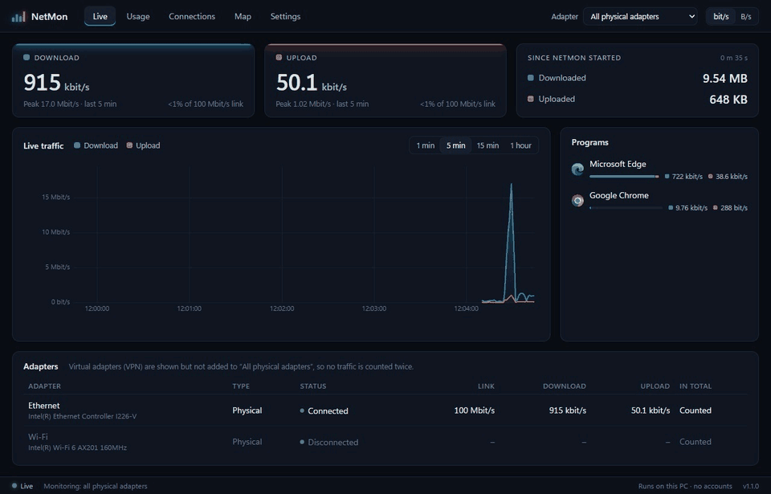
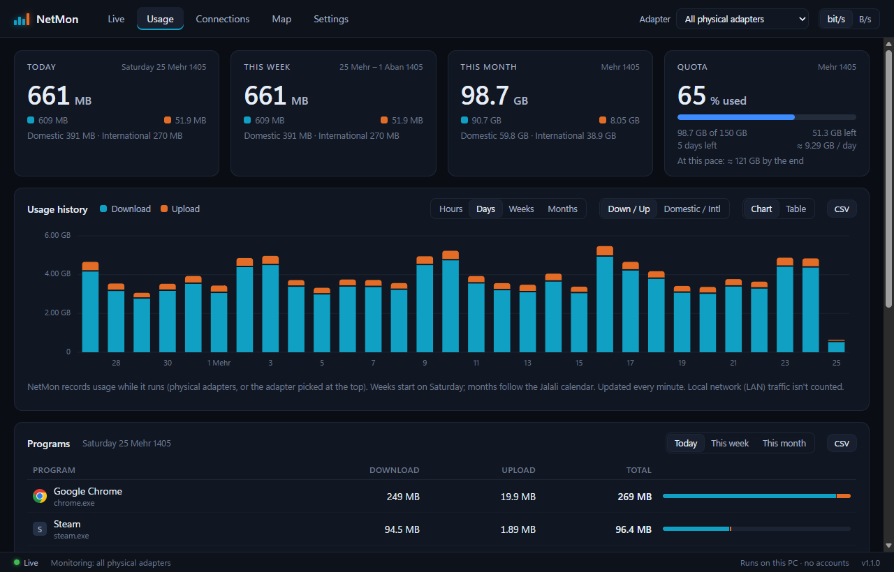
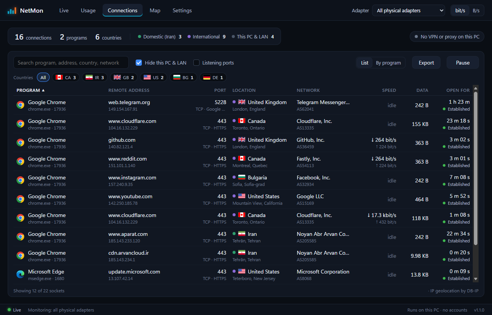
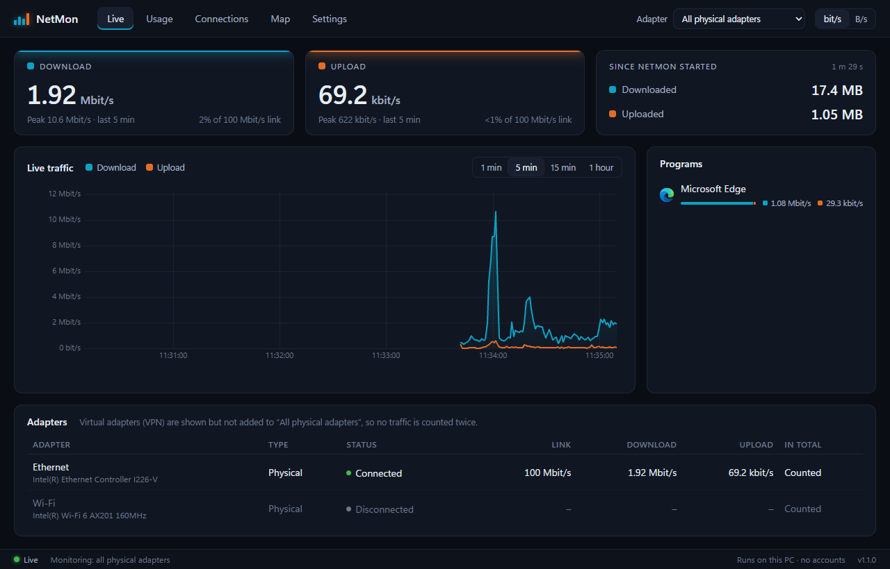
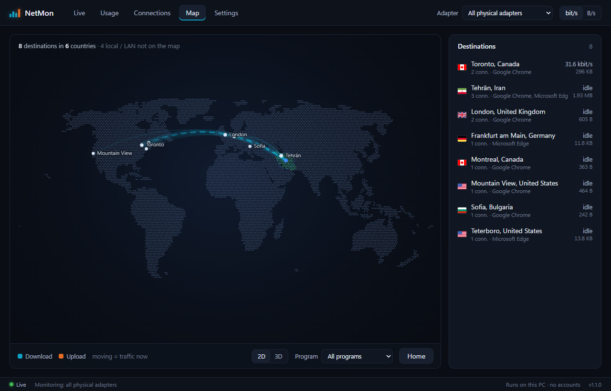
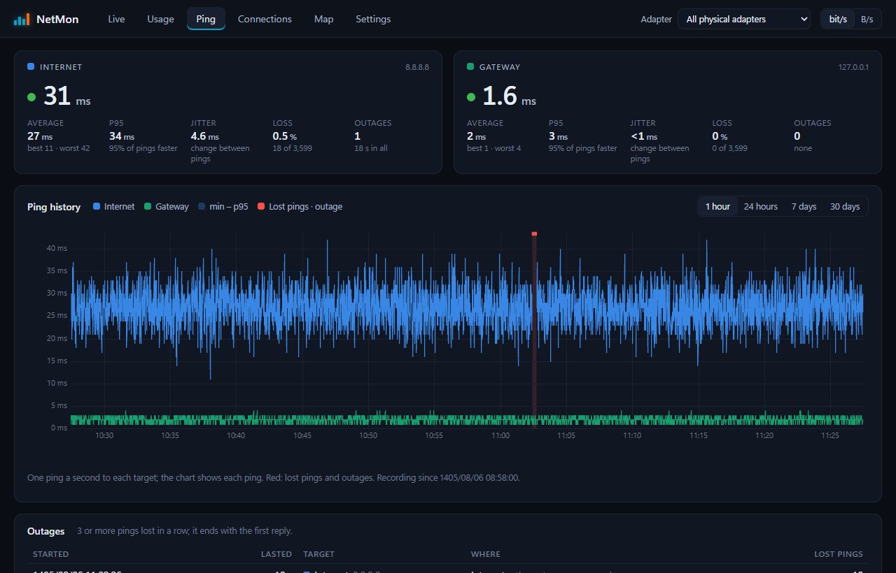
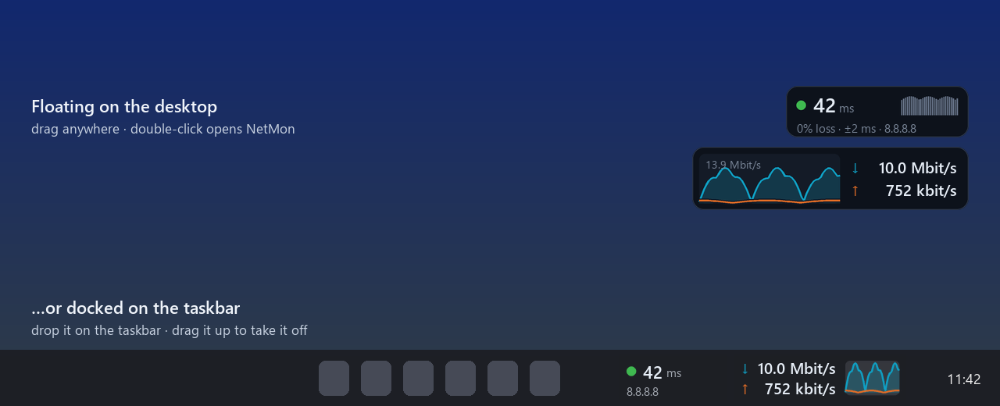

# NetMon

[English](README.md) · **فارسی**

یک نرم‌افزار مانیتورینگ شبکه برای ویندوز، محلی و آفلاین، شبیه NetWorx: سرعت لحظه‌ای،
تاریخچه‌ی مصرف و سهمیه‌ی اینترنت، ترافیک هر برنامه، جدول زنده‌ی اتصال‌ها با نام برنامه
و موقعیت جغرافیایی، و نقشه‌ی جهان که نشان می‌دهد ترافیک شما به کجا می‌رود.

همه‌چیز روی کامپیوتر خودتان اجرا می‌شود. بدون حساب کاربری، بدون سرور ابری و بدون
ارسال آمار. همه‌ی کتابخانه‌ها، فونت‌ها و داده‌های نقشه داخل برنامه هستند؛ تنها دانلود
اختیاری، دیتابیس رایگان GeoIP برای تب Connections است (با یک کلیک در تنظیمات).



## امکانات

- **سرعت لحظه‌ای**: دانلود و آپلود در هر ثانیه، برای همه‌ی کارت‌های شبکه‌ی فیزیکی یا
  کارتی که انتخاب کنید، با نمودار چند دقیقه‌ی اخیر.
- **آیکون tray**: یک نمودار کوچک زنده؛ با بردن موس روی آن، سرعت‌ها را می‌بینید.
- **مینی‌گراف و ویجت پینگ**: ویجت‌های کوچکی که همیشه روی صفحه هستند؛ روی دسکتاپ
  شناور می‌مانند یا **روی تسک‌بار می‌نشینند**. هنگام بازی و ویدیوی تمام‌صفحه پنهان می‌شوند.
- **تاریخچه‌ی مصرف**: ساعتی، روزانه، هفتگی و ماهانه با **تقویم شمسی**، به‌صورت نمودار یا جدول.
- **تاریخچه‌ی پینگ**: تأخیر، loss و jitter به اینترنت و روتر، همیشه در پس‌زمینه ضبط می‌شود؛
  قطعی‌ها از یک ساعت تا ۳۰ روز اخیر فهرست می‌شوند.
- **سهمیه‌ی اینترنت (حجم بسته)**: ماهانه، روزانه یا هر N روز (بسته‌های پیش‌پرداخت)، با
  هشدار در ۸۰٪ و ۱۰۰٪. ترافیک داخلی می‌تواند با ضریب کمتر حساب شود.
- **ترافیک هر برنامه**: کدام برنامه چقدر مصرف می‌کند، همین حالا و در طول زمان
  (با درایور رایگان Npcap).
- **اتصال‌ها (Connections)**: هر اتصال با نام و آیکون برنامه، نام میزبان، کشور، شهر و
  شبکه (ISP)؛ مثل TCPView همراه با موقعیت جغرافیایی.
- **نقشه**: نقشه‌ی مسطح جهان یا کره‌ی سه‌بعدی، با کمان‌های متحرک به هر جایی که کامپیوتر
  شما با آن در ارتباط است.
- **تشخیص VPN و پروکسی**: کارت شبکه‌ی VPN، برنامه‌ی VPN یا پروکسی سیستمی ویندوز را نشان می‌دهد.
- **کل شبکه‌ی خانه (اختیاری)**: با روتر MikroTik، مصرف همه‌ی دستگاه‌های خانه، به تفکیک
  داخلی و بین‌المللی.
- **خروجی CSV**، اجرا همراه ویندوز، مصرف کم منابع (حدود ۵۰ مگابایت در پس‌زمینه؛ موتور
  مرورگرِ پنجره با بستن آن آزاد می‌شود).

| | |
|---|---|
|  |  |
|  |  |
|  | |



## نصب

**پیش‌نیاز:** ویندوز ۱۰ یا ۱۱، ۶۴ بیتی، با Edge WebView2 (در ویندوز ۱۱ از قبل هست؛ در
ویندوز ۱۰ همراه مرورگر Edge نصب می‌شود).

1. فایل **`NetMon-Setup-<version>.exe`** را از صفحه‌ی
   [Releases](https://github.com/sadi754/netmon/releases) دانلود و اجرا کنید.
   دسترسی مدیر (admin) لازم نیست: NetMon فقط برای کاربر شما و در مسیر
   `%LOCALAPPDATA%\Programs\NetMon` نصب می‌شود.
2. فایل نصب امضای دیجیتال ندارد، برای همین ممکن است ویندوز پیام «Windows protected your PC»
   بدهد. روی **More info** و بعد **Run anyway** بزنید.
3. زبان (فارسی یا انگلیسی) را انتخاب کنید. ساخت میان‌بر روی دسکتاپ و **اجرای NetMon هنگام
   ورود به ویندوز** اختیاری است.

برای آپدیت، فایل نصب نسخه‌ی جدید را اجرا کنید؛ داده‌ها و تنظیمات شما می‌مانند. برای حذف،
از **Settings → Apps** ویندوز استفاده کنید؛ می‌پرسد که داده‌ها هم پاک شوند یا نه.

**نسخه‌ی قابل‌حمل (بدون نصب):** فایل `NetMon-<version>-win64.zip` را هر جا که خواستید
باز کنید و `NetMon\NetMon.exe` را اجرا کنید. اگر کنار `NetMon.exe` پوشه‌ای به نام `data`
بسازید، NetMon همه‌چیز را همان‌جا نگه می‌دارد (مناسب فلش).

### پیشنهادی: Npcap، برای ترافیک هر برنامه

[Npcap](https://npcap.com) درایور رایگان ضبط بسته است که Wireshark هم از آن استفاده
می‌کند. مجوزش اجازه نمی‌دهد همراه برنامه پخش شود، پس خودتان نصبش کنید. در مراحل نصبش، گزینه‌ی
**"Restrict Npcap driver's access to Administrators only"** را تیک نزنید تا NetMon بدون
دسترسی admin بتواند کار کند. بدون Npcap هم بقیه‌ی امکانات کار می‌کنند.

## قدم‌های اول

1. NetMon پنجره‌اش را باز می‌کند و یک آیکون در tray می‌گذارد. ویندوز ۱۱ آیکون‌های جدید را
   پشت فلش **^** پنهان می‌کند؛ آیکون را روی تسک‌بار بکشید تا همیشه دیده شود.
2. **Settings → Connections → Home country**: کشورتان را انتخاب کنید. این تعیین می‌کند
   چه ترافیکی «داخلی» حساب شود (حالت خودکار = منطقه‌ای که در ویندوز تنظیم شده، که اغلب
   ایران نیست).
3. **تب Connections → Download**: دیتابیس رایگان GeoIP را دانلود کنید (حدود ۶۵ مگابایت،
   یک بار) تا کشور، شهر و شبکه‌ها را ببینید.
4. اختیاری: **Settings → Data quota** با حجم بسته‌ی اینترنت‌تان.

بستن پنجره، NetMon را در tray روشن نگه می‌دارد. اگر NetMon در حال اجرا باشد، اجرای دوباره‌اش
فقط پنجره را برمی‌گرداند. برای خروج، از منوی آیکون tray استفاده کنید.

## راهنما

### ویجت‌ها: مینی‌گراف و پینگ

- **مینی‌گراف**: ترافیک یک دقیقه‌ی اخیر و سرعت فعلی.
  **ویجت پینگ**: پینگ زنده به سروری که انتخاب می‌کنید (مثلاً سرور بازی): زمان پینگ، یک
  نقطه‌ی رنگی کیفیت (سبز زیر ۶۰ میلی‌ثانیه، زرد زیر ۱۲۰، قرمز بیشتر یا قطع)، ۳۰ پینگ آخر،
  درصد loss و jitter.
- ویجت را هر جا که خواستید **بکشید**؛ دبل‌کلیک NetMon را باز می‌کند؛ راست‌کلیک برای
  **Opacity** (شفافیت)، **Hide** (پنهان کردن) و در ویجت پینگ **Change target…** (تغییر مقصد).
  ویجت پنهان را از منوی tray دوباره نشان دهید.
- **روی تسک‌بار:** ویجت را روی تسک‌بار رها کنید تا به شکل جمع‌وجور آنجا بنشیند؛ روی تسک‌بار
  به چپ و راست جابه‌جایش کنید و برای برداشتن، آن را به بالا بکشید. یا از راست‌کلیک گزینه‌ی
  **Move to taskbar / Move out of taskbar** را بزنید. رنگ متن با حالت روشن یا تیره‌ی ویندوز
  هماهنگ می‌شود. (با تسک‌بارِ auto-hide کار نمی‌کند؛ فقط مانیتور اصلی.)
- وقتی بازی یا ویدیوی تمام‌صفحه جلوست، ویجت‌های آن مانیتور پنهان می‌شوند
  (Settings → Floating widgets).
- ویجت پینگ هر ثانیه یک بسته‌ی کوچک ICMP می‌فرستد، و فقط وقتی نمایش داده می‌شود. فعلاً فقط IPv4.

### تاریخچه‌ی مصرف و سهمیه‌ی اینترنت

NetMon ترافیک هر کارت شبکه را هر دقیقه، به‌صورت جمع ساعتی، در یک دیتابیس کوچک SQLite ذخیره
می‌کند (یک سال حدود ۱ مگابایت، به‌علاوه‌ی چند مگابایت برای تاریخچه‌ی برنامه‌ها). تب
**Usage** امروز، این هفته و این ماه را نشان می‌دهد، و نموداری ساعتی، روزانه، هفتگی (از شنبه)
یا ماهانه با تقویم شمسی، یا جدول.

در تنظیمات **سهمیه (Data quota)** را روشن کنید: برای هر ماه شمسی، هر روز، یا هر N روز از یک
تاریخ شروع (بسته‌های پیش‌پرداخت)، با شمارش دانلود + آپلود یا فقط دانلود. تب Usage آن وقت
نشان می‌دهد چقدر مصرف شده و چقدر مانده، چند روز مانده، روزی چقدر می‌شود مصرف کرد، و با این
سرعت مصرف به کجا می‌رسید. در ۸۰٪ و ۱۰۰٪ اعلان ویندوز نمایش داده می‌شود (یک بار در هر دوره)؛
tooltip آیکون tray هم سهمیه را نشان می‌دهد.

NetMon به‌تنهایی **فقط همین کامپیوتر** را می‌شمارد؛ دستگاه‌های دیگری که از همان بسته استفاده
می‌کنند حساب نمی‌شوند (بخش «کل شبکه» را ببینید). ۱ گیگابایت = ۱۰۲۴ مگابایت؛ بعضی
اپراتورها ۱۰۰۰ حساب می‌کنند. با روشن بودن ترافیک برنامه‌ها، ترافیکی که داخل شبکه‌ی محلی
می‌ماند شمرده نمی‌شود، و ترافیک داخلی می‌تواند با ضریب کمتر (مثلاً ۵۰٪) حساب شود.

### تاریخچه‌ی پینگ

NetMon هر ثانیه، در پس‌زمینه (حتی وقتی ویجت پنهان است)، به مقصد اینترنتی‌تان (پیش‌فرض
`8.8.8.8`) و به روترتان پینگ می‌زند؛ پینگ‌های تکی تا ۷ روز و آمار دقیقه‌ای و قطعی‌ها برای
همیشه نگه داشته می‌شوند (حدود ۱۰ مگابایت ترافیک در روز). تب **Ping** تأخیر، loss و jitter را
به‌صورت نمودار برای ۱ ساعت، ۲۴ ساعت، ۷ یا ۳۰ روز اخیر (محدوده‌ی min تا p95) نشان می‌دهد، و
**قطعی‌ها** را فهرست می‌کند: ۳ یا بیشتر پینگ پشت‌سرهم از دست رفته، تا اولین پاسخی که برمی‌گردد،
همراه با اینکه روتر هم جواب داده یا نه (تا بفهمید مشکل از شبکه‌ی خودتان است یا اینترنت).
خاموش کردن ضبط، تغییر مقصد یا روتر پینگ‌شونده، یا حذف تاریخچه: از **Settings → Ping**.

### ترافیک هر برنامه (Npcap)

با نصب Npcap، NetMon بسته‌های کارت‌های شبکه‌ی فیزیکی را ضبط می‌کند و تشخیص می‌دهد هر بسته
مال کدام برنامه است. خاموش کردن: Settings → Per-program traffic.

- صفحه‌ی **Live**: فهرست **Programs** با سرعت دانلود و آپلود هر برنامه. روی هر کدام بزنید
  تا اتصال‌هایش را ببینید.
- **Connections**: سرعت و حجم هر اتصال؛ ترافیک UDP (بازی‌ها، تماس‌ها، QUIC یوتیوب) با مقصد
  واقعی؛ و نام واقعی سایت‌ها، یعنی نامی که برنامه درخواست کرده (از پاسخ‌های DNS خود کامپیوتر
  و پیام «hello» در TLS)، مثلاً `www.youtube.com` به‌جای `...1e100.net`.
- **Usage**: جدول **Programs** (امروز / این هفته / این ماه) و تفکیک **داخلی / بین‌المللی**
  ترافیک این کامپیوتر.

NetMon از هر بسته فقط ۹۶ بایت اول (آدرس‌ها، پورت‌ها، اندازه) را در حافظه نگه می‌دارد؛ فقط
جمع مصرف برنامه‌ها ذخیره می‌شود. هزینه‌اش حدود ۱ تا ۳ درصد یک هسته‌ی CPU است (اندازه‌گیری‌شده:
۲٫۳٪ در ۲۵ مگابیت بر ثانیه، بدون از دست رفتن بسته). محدودیت‌ها: VPN یا پروکسی سیستمی که
*روی خود کامپیوتر* اجرا شود همه‌چیز را تونل می‌کند، پس آن ترافیک به نام برنامه‌ی VPN یا
پروکسی نمایش داده می‌شود (VPN روی روتر این مشکل را ندارد). اتصالی که کسری از ثانیه طول بکشد
ممکن است «Unknown program» نمایش داده شود.

### اتصال‌ها (Connections)

همه‌ی اتصال‌های TCP و پورت‌های باز این کامپیوتر، مثل `netstat -ano` یا TCPView، با
به‌روزرسانی هر ۲ ثانیه:

- **برنامه** با آیکون و نام ("Google Chrome" به‌جای `chrome.exe`)؛ برای `svchost.exe`،
  سرویس‌های ویندوز داخل آن (مثلاً *Windows Update*).
- **آدرس مقصد** با نام میزبان (reverse DNS، قابل خاموش کردن)، پورت و کاربردش، **موقعیت**
  (پرچم، کشور، شهر)، **شبکه** (مثلاً *Google LLC*، *Cloudflare*، با شماره‌ی AS)، وضعیت و مدت.
- نقطه‌ی سبز = **داخلی**، بنفش = بین‌المللی (بر اساس Home country در تنظیمات).
- جست‌وجو، فیلتر کشور، گروه‌بندی **By program**، مرتب‌سازی، **Pause**، پنل جزئیات،
  خروجی **CSV** و **Show on map**.

موقعیت‌ها از **دیتابیس رایگان GeoIP شرکت DB-IP** (City Lite + ASN Lite) می‌آیند. با
درخواست شما دانلود می‌شود (حدود ۶۵ مگابایت، ۱۳۰ مگابایت روی دیسک) و هر ماه از
Settings → Connections قابل به‌روزرسانی است. همه‌ی جست‌وجوها روی کامپیوتر خودتان انجام
می‌شود. NetMon جدول اتصال‌ها را فقط وقتی تب باز است می‌خواند.

### نقشه (Map)

مقصد اتصال‌های این کامپیوتر، روی نقشه‌ی **2D** جهان (پیش‌فرض) یا کره‌ی **3D**: یک نقطه‌ی
درخشان در خانه و یک کمان به هر شهر. کمان‌هایی که الان ترافیک دارند پررنگ‌ترند و خط‌چین‌هایشان
در جهت جریان داده حرکت می‌کند: **آبی** به سمت خانه (دانلود)، **نارنجی** از خانه به بیرون
(آپلود). فهرست **Destinations** مقصدها را به ترتیب ترافیک نشان می‌دهد؛ روی هر مقصد، نقطه یا
کمان بزنید تا برنامه‌ها و اتصال‌هایش را ببینید. با چرخ موس زوم کنید و با کشیدن جابه‌جا کنید.
نقشه فقط وقتی تبش باز است کشیده می‌شود.

### کل شبکه: روتر MikroTik (اختیاری)

با روتر MikroTik (RouterOS 7)، NetMon می‌تواند مصرف اینترنت **کل شبکه** را نشان دهد: همه‌ی
دستگاه‌ها، به تفکیک داخلی و بین‌المللی. سهمیه‌ی اینترنت هم می‌تواند از روی همین عددها حساب
شود. فقط شمارنده‌های بایت WAN روتر خوانده می‌شود. گزینه‌ی
**Settings → Integrations → MikroTik router** را روشن کنید و یکی از این روش‌ها را انتخاب کنید:

- **مستقیم:** NetMon هر دقیقه خودش روتر را می‌خواند و سروری لازم نیست. ساده‌ترین روش است،
  ولی اگر وقتی NetMon اجرا نمی‌شود روتر ری‌استارت شود، مصرف از آخرین خواندن تا ری‌استارت از
  دست می‌رود. ساعت‌هایی که NetMon نخوانده، به‌صورت تخمینی (میله‌های کم‌رنگ) پر می‌شوند.
- **رله‌ی PHP:** روتر هر دقیقه به یک برنامه‌ی کوچک روی هر هاست PHP گزارش می‌دهد (یک فایل
  zip آپلود کنید و `setup.php` را باز کنید). وقتی کامپیوتر خاموش است هم چیزی از دست نمی‌رود.
- **رله‌ی Cloudflare:** همان، روی Cloudflare Workers و D1، رایگان (در ایران ممکن است روتر فقط
  از مسیر VPN به آن برسد).

راهنمای قدم‌به‌قدم: [relay/README.fa.md](relay/README.fa.md).

### کارت‌های شبکه و VPN

جمع کل فقط **کارت‌های فیزیکی** (Ethernet، Wi-Fi) را می‌شمارد. VPN روی کامپیوتر یک کارت
مجازی اضافه می‌کند و هر بایت از هر دو عبور می‌کند؛ جمع زدنشان ترافیک را دو بار حساب می‌کرد.
کارت‌های مجازی همچنان فهرست می‌شوند؛ از منوی **Adapter** در پنجره می‌توانید هر کارت را
جداگانه انتخاب کنید.

### خروجی و داده‌ها

- دکمه‌های **CSV** در صفحه‌های Usage، Router و Connections آنچه را نمایش داده می‌شود برای
  Excel ذخیره می‌کنند. Settings → General → **Export all data** همه‌ی ساعت‌های ثبت‌شده را با
  بایت دقیق، به‌صورت یک zip از فایل‌های CSV ذخیره می‌کند.
- داده‌های شما (تنظیمات، تاریخچه، فایل‌های GeoIP، لاگ‌ها) در `%LOCALAPPDATA%\NetMon` است
  (Settings → General → **Open folder**).

### حریم خصوصی

پنجره از طریق یک وب‌سرور کوچک با NetMon حرف می‌زند که فقط روی `127.0.0.1` گوش می‌دهد و
یک توکن تصادفی می‌خواهد که در هر اجرا ساخته می‌شود؛ پس نه کامپیوترهای دیگر و نه سایت‌هایی که
در مرورگرتان باز است نمی‌توانند آن را بخوانند. NetMon فقط برای امکاناتی که استفاده می‌کنید
چیزی به شبکه می‌فرستد:

- **نام میزبان‌ها** (Connections، پیش‌فرض روشن): درخواست‌های reverse DNS به همان DNS
  معمول شما می‌رود. در تنظیمات خاموش می‌شود.
- **دیتابیس GeoIP**: وقتی Download یا Update را بزنید از `download.db-ip.com` دانلود
  می‌شود. آدرس‌ها هرگز برای مکان‌یابی به جایی فرستاده نمی‌شوند.
- **ویجت پینگ**: تا وقتی نمایش داده می‌شود، مقصدی را که تعیین کرده‌اید پینگ می‌کند.
- **روتر MikroTik** (پیش‌فرض خاموش): شمارنده‌های بایت روتر را می‌خواند؛ یا مستقیم در شبکه‌ی
  داخلی شما، یا از رله‌ی خودتان.

## رفع مشکلات رایج

- **«Windows protected your PC»**: فایل نصب و exe امضا ندارند:
  **More info → Run anyway**.
- **فهرست Programs خالی است / همه‌جا «Unknown program»**: Npcap را بدون تیک گزینه‌ی
  *"Restrict … to Administrators only"* نصب کنید و NetMon را دوباره اجرا کنید.
- **پنجره خالی یا سفید است**: NetMon ظرف چند ثانیه خودش صفحه را دوباره بار می‌کند. اگر خالی
  ماند، پنجره را ببندید و دوباره باز کنید و فایل `window.log` را در پوشه‌ی داده‌ها ببینید.
- **آیکون tray پیدا نیست**: ویندوز ۱۱ آن را پشت **^** پنهان می‌کند؛ روی تسک‌بار بکشیدش.
- **گزینه‌ی «Move to taskbar» غیرفعال است**: تسک‌بار روی auto-hide تنظیم شده.
- **تب Router در حالت مستقیم پیام «not allowed» یا «refused» می‌دهد**: اسکریپت setup را دوباره
  اجرا کنید (مجوزها و رمز کاربر را تنظیم می‌کند). سرویس `www` روتر هم باید اجازه‌ی دسترسی از
  آدرس کامپیوتر شما را داشته باشد.
- **لاگ‌ها**: `netmon.log` و `window.log` در `%LOCALAPPDATA%\NetMon`
  (Settings → About → Open log file).

## ساخت از روی سورس

به Python نسخه‌ی ۳٫۱۰ یا جدیدتر نیاز دارد (توسعه با ۳٫۱۲).

```
run.bat                 اجرای NetMon از روی سورس
run.bat --minimized     اجرا فقط در tray
run.bat --console       سرعت زنده در ترمینال (Q برای خروج)
run.bat --list          فهرست کارت‌های شبکه
run.bat --debug         برنامه‌ی دسکتاپ با پیام‌های لاگ در ترمینال
build.bat               ساخت NetMon.exe، فایل zip و فایل نصب
```

اولین اجرای `run.bat` یک محیط Python اختصاصی در `.venv` می‌سازد و بسته‌های
`requirements.txt` را نصب می‌کند (به Python سیستم دست نمی‌زند). در اجرا از روی سورس،
داده‌ها در پوشه‌ی `data` داخل پروژه ذخیره می‌شوند.

`build.bat` ابزار PyInstaller را نصب می‌کند، بعد `dist\NetMon\` (فایل NetMon.exe و
فایل‌هایش)، `dist\NetMon-<version>-win64.zip` و اگر
[Inno Setup 6](https://jrsoftware.org/isinfo.php) نصب باشد
(`winget install JRSoftware.InnoSetup`) فایل `dist\NetMon-Setup-<version>.exe` را می‌سازد.
شماره‌ی نسخه در `netmon/__init__.py` است. ساختار پوشه‌ها در
[README انگلیسی](README.md#build-from-source) آمده است.

## منابع و قدردانی

- مکان‌یابی IP توسط [DB-IP](https://db-ip.com)، با مجوز
  [CC BY 4.0](https://creativecommons.org/licenses/by/4.0/) (با درخواست کاربر دانلود می‌شود).
- نمودارها: [uPlot](https://github.com/leeoniya/uPlot) (MIT).
- کره‌ی سه‌بعدی: [globe.gl](https://github.com/vasturiano/globe.gl) با
  [three.js](https://threejs.org) (MIT).
- پرچم کشورها: [country-flag-icons](https://gitlab.com/catamphetamine/country-flag-icons) (MIT).
- مرز کشورها: [Natural Earth](https://www.naturalearthdata.com) (مالکیت عمومی).
- ضبط بسته: [Npcap](https://npcap.com) (جداگانه نصب می‌شود).
- محدوده‌های IP ایران برای لیست داخلی روتر:
  [mo13ammad/Country-IP-List](https://github.com/mo13ammad/Country-IP-List).
- بسته‌های Python: Starlette، uvicorn، websockets، pywebview، pystray، Pillow، maxminddb.
- فایل نصب: [Inno Setup](https://jrsoftware.org/isinfo.php)، ترجمه‌ی فارسی از
  [Peyman Mohammadi](https://github.com/peymanr34/inno-setup-translations).

## مجوز

[MIT](LICENSE) © 2026 sadi754
